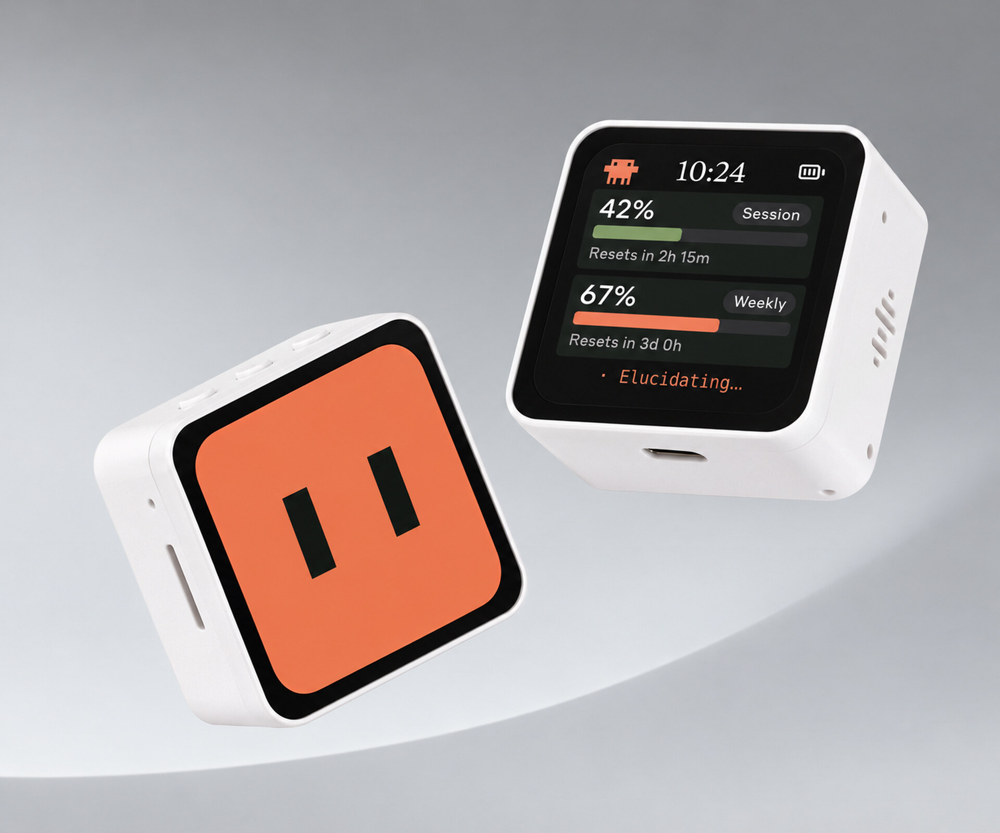
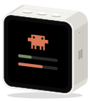
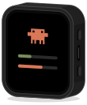
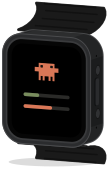
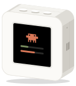
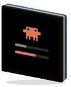
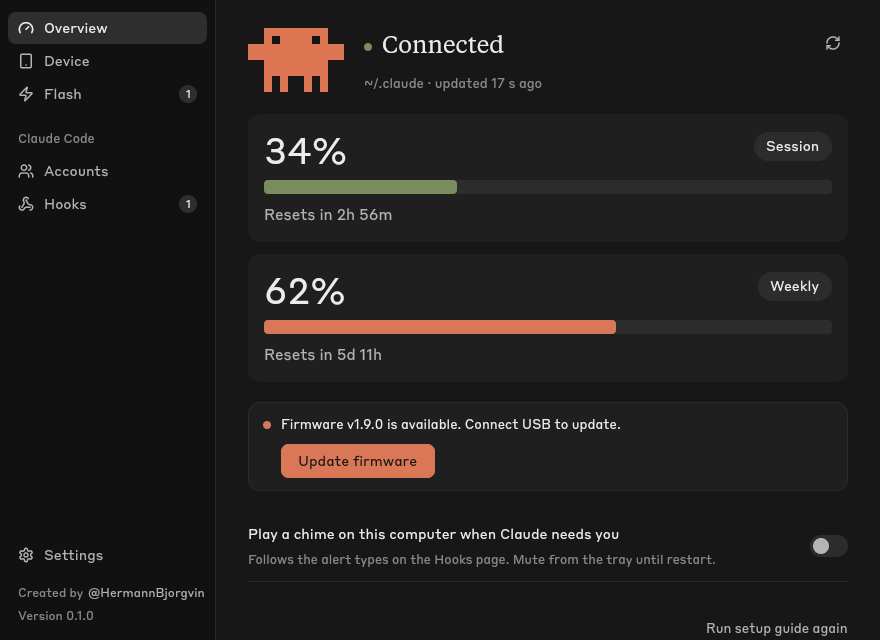

# Clawdmeter

Clawdmeter shows your Claude Code usage limits on an ESP32 development board on your desk. Clawd lives on the device. He reacts to prompts, cheers you on, and alerts you when a session needs your attention.

## Supported boards

|                                                                                                        | Board                                                                                                           |                                                                                               |
| :----------------------------------------------------------------------------------------------------: | --------------------------------------------------------------------------------------------------------------- | --------------------------------------------------------------------------------------------- |
|     | [Waveshare ESP32-S3-Touch-AMOLED-2.16](https://www.waveshare.com/esp32-s3-touch-amoled-2.16.htm?&aff_id=149786) | 480×480 AMOLED, 3 buttons, speaker. Original board.                                           |
|  | [Waveshare ESP32-C6-Touch-AMOLED-2.16](https://www.waveshare.com/esp32-c6-touch-amoled-2.16.htm?&aff_id=149786) | 480×480 AMOLED on the ESP32-C6 (no PSRAM; animated corner Clawd, text-only attention alerts). |
|      | [Waveshare ESP32-S3-Touch-AMOLED-1.8](https://www.waveshare.com/esp32-s3-touch-amoled-1.8.htm?&aff_id=149786)   | 368×448 AMOLED, 2 buttons, speaker.                                                           |
|   | [Waveshare ESP32-C6-Touch-AMOLED-1.8](https://www.waveshare.com/esp32-c6-touch-amoled-1.8.htm?&aff_id=149786)   | 368×448 AMOLED on the ESP32-C6.                                                               |
|     | [Waveshare ESP32-S3-Touch-AMOLED-2.06](https://www.waveshare.com/esp32-s3-touch-amoled-2.06.htm?&aff_id=149786) | 410×502 AMOLED in a watch case.                                                               |
|        | [Waveshare ESP32-S3-Touch-LCD-1.54](https://www.waveshare.com/esp32-s3-lcd-1.54.htm?sku=33869&aff_id=149786)    | 240×240 IPS, 3 buttons, speaker. Smallest supported display.                                  |
|          | [Waveshare ESP32-S3-Touch-LCD-4](https://www.waveshare.com/esp32-s3-touch-lcd-4.htm?&aff_id=149786)             | 480×480 IPS, 4 inches, one button.                                                            |

## Install

Download the app from the [latest release](https://github.com/HermannBjorgvin/Clawdmeter/releases/latest).

| OS             | Package     | Install                                                                                                                          |
| -------------- | ----------- | -------------------------------------------------------------------------------------------------------------------------------- |
| macOS          | `.dmg`      | Drag Clawdmeter to Applications. If blocked, use **System Settings → Privacy & Security → Open Anyway**. Allow Bluetooth access. |
| Windows        | `.msi`      | Run the installer. If SmartScreen blocks it, choose **More info → Run anyway**.                                                  |
| Debian, Ubuntu | `.deb`      | `sudo apt install ./clawdmeter_<version>_amd64.deb`                                                                              |
| Other Linux    | `.AppImage` | `chmod +x clawdmeter-*.AppImage`, then run it.                                                                                   |
| NixOS, Nix     | Flake       | `nix run github:HermannBjorgvin/Clawdmeter`                                                                                      |

The macOS and Windows packages aren't signed with a publisher certificate.
See the [user guide](docs/user-guide.md#installation) for Linux requirements,
portable archives, and Nix setup.

## Quick start

1. Launch Clawdmeter and follow setup. Connect the board with a USB data
   cable, check the selected board, and install firmware.
2. Pair **Clawdmeter** in your computer's Bluetooth settings. It appears as
   a keyboard because its buttons send key presses.
3. Open **Hooks** to let Clawd react to Claude Code activity and alert when
   a session needs an answer. Review the changes before saving.
   Usage meters work without hooks.
4. Enable **Settings → Start at login** if you want the app to launch when
   you sign in.

## Docs

- [User guide](docs/user-guide.md): setup, device controls, settings, and connection help.
- [Development](docs/development.md): builds, simulator, and releases.
- [Add a board](docs/porting/adding-a-board.md): hardware ports and app integration.
- [BLE protocol](docs/protocol.md): payload fields and notifications.
- [Clawd's director](docs/clawd-director.md): behavior and character rules.
- [Legacy daemon parity](docs/daemon-parity.md): upgrade steps and implementation differences.

## Licensing gray area warning

The software in this repository uses and adheres to the Anthropic brand guidelines and uses the same proprietary fonts that Anthropic has a license for but this software uses without permission as well as using assets from Anthropic such as the copyrighted Clawd mascot so even though the code in this repo is non-proprietary I will not license it myself under a copyleft license since this repo includes proprietary fonts and copyrighted assets. Please be aware of this if you fork or copy the code from this repo. **You have been warned!**
