# Clawdmeter

[](https://techcrunch.com/2026/05/14/clawdmeter-turns-your-claude-code-usage-stats-into-a-tiny-desktop-dashboard/)

<picture>
  <source media="(prefers-color-scheme: dark)" srcset="docs/images/clawdmeter-hero-dark.jpg">
  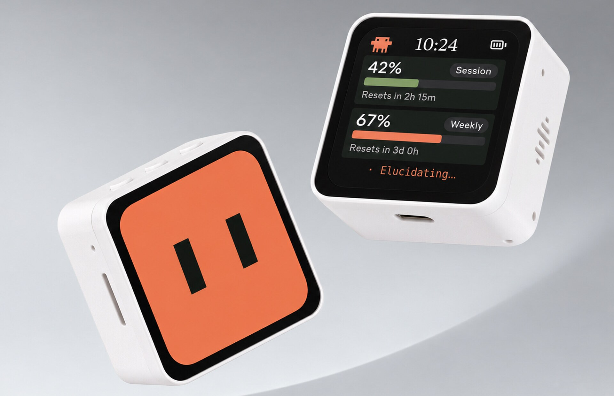
</picture>

Clawdmeter shows your Claude Code usage limits on an [ESP32 development board](#supported-boards) on your desk. Clawd lives on the device. He reacts to prompts, cheers you on, and alerts you when a session needs your attention.

## This fork: ASCII pets on the 4-inch Waveshare screen

This is a fork of [HermannBjorgvin/Clawdmeter](https://github.com/HermannBjorgvin/Clawdmeter).
It adds a pet build of the firmware for the Waveshare ESP32-S3-Touch-LCD-4
and a few changes for an account with no 5-hour limit. Everything below this
section is the original README; the stock firmware and app still build from
this tree unchanged.

### What it changes

- **ASCII pets in place of Clawd.** The 18 pets from
  [claude-desktop-buddy](https://github.com/anthropics/claude-desktop-buddy)
  (MIT) sit in Clawd's corner of the meters and follow what Claude Code is
  doing: idle, busy, attention on an alert, celebrate on a reset, dizzy at
  100 %.
- **Pet screensaver and peek.** The screensaver is the pet, large and asleep
  on black. A tap on the meters brings it up awake with its stats; a tap in
  the left or right third of the screen changes the species.
- **Pet stats.** Level and "fed" grow as the usage meter rises (on an account
  with no 5-hour limit: a level per full week, a pip per 10 %). Mood follows
  how quickly alerts are answered, energy follows naps on the screensaver.
- **Alerts name the session.** The alert line reads `Permission: my-project`
  or `Question: my-project`, using the name of the session's working
  directory, so you know which terminal is waiting. `alert_project = off` in
  the app's config restores the fixed lines.
- **A Fable card.** On an account with no 5-hour limit, the free second card
  shows Fable's weekly limit as its own meter, in place of the strip inside
  the Weekly bar.

The pet build is a compile-time option (`-DPET_ASCII`, environments
`waveshare_lcd_4_pets` and `sim_pets`). Design, states and the stats rules
are in [docs/pets.md](docs/pets.md).

### Materials

- **Screen:** Waveshare ESP32-S3-Touch-LCD-4, 480×480, tested on the V4.0
  revision. Pinout, schematic and revisions are on the
  [Waveshare wiki](https://www.waveshare.com/wiki/ESP32-S3-Touch-LCD-4).
- **Case:** [Clawdmeter case for the 4-inch screen](https://makerworld.com/en/models/3367042-clawdmeter-case-4-inch-screen#profileId-3829075)
  on MakerWorld, to 3D-print.
- A USB-C data cable. The board is meant to stay on USB power.

### Install (macOS, from source)

The fork publishes no releases, so both halves are built here. You need
[PlatformIO](https://platformio.org/install/cli), Rust (the toolchain in
`desktop/rust-toolchain.toml` installs itself) and Xcode with its Metal
Toolchain (`xcodebuild -runFirstLaunch`, then
`xcodebuild -downloadComponent MetalToolchain`).

1. **Flash the board.** Plug it in by its USB port, then:

   ```bash
   pio run -d firmware -e waveshare_lcd_4_pets -t upload
   ```

   If the upload can't connect, hold **BOOT**, press and release **PWR**
   (the reset key on this board), release **BOOT**, and run it again; press
   **PWR** afterwards to start the firmware.

2. **Build and install the app.**

   ```bash
   tools/packaging/local-mac-app.sh
   cp -R desktop/target/dist/Clawdmeter.app /Applications/
   ```

   Open it from Applications. The first launch is blocked (the app is only
   ad-hoc signed): **System Settings → Privacy & Security → Open Anyway**,
   then allow Bluetooth access.

3. **Skip the firmware step in setup and don't use the Flash page.** The app
   sees the board as a stock `waveshare_lcd_4` and would replace the pet
   build with the official firmware. Add `update_check = off` to
   `~/.config/clawdmeter/config` to stop the update prompts.

4. **Pair.** System Settings → Bluetooth → **Connect** next to
   **Clawdmeter**.

5. **Install the hooks.** Open **Hooks** in the app, review the changes to
   Claude Code's `settings.json` and save. Sessions already running pick the
   hooks up after a restart.

To try the pet build without a board:
`pio run -d firmware -e sim_pets && (cd firmware && .pio/build/sim_pets/program)`.
`firmware/sim/pets-tour.jsonl` is a two-minute tour of everything above.

## Supported boards

### Flagship

The reference board: everything is developed and tested on it first.

|                                                                                                        | Board                                                                                                           |                                                                                               |
| :----------------------------------------------------------------------------------------------------: | --------------------------------------------------------------------------------------------------------------- | --------------------------------------------------------------------------------------------- |
|  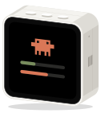   | [Waveshare ESP32-S3-Touch-AMOLED-2.16](https://www.waveshare.com/esp32-s3-touch-amoled-2.16.htm?&aff_id=149786) | 480×480 AMOLED, 3 buttons, speaker. Original board.                                           |

Using a different board? See [other supported boards](#other-supported-boards).

## Install

Download the app from the [latest release](https://github.com/HermannBjorgvin/Clawdmeter/releases/latest).

| OS             | Package     | Install                                                                                                                          |
| -------------- | ----------- | -------------------------------------------------------------------------------------------------------------------------------- |
| macOS          | `.dmg`      | Drag Clawdmeter to Applications. If blocked, use **System Settings → Privacy & Security → Open Anyway**. Allow Bluetooth access. |
| Windows        | `.msi`      | Run the installer. If SmartScreen blocks it, choose **More info → Run anyway**.                                                  |
| Debian, Ubuntu | `.deb`      | `sudo apt install ./clawdmeter_<version>_amd64.deb`                                                                              |
| Other Linux    | `.AppImage` | `chmod +x clawdmeter-*.AppImage`, then run it.                                                                                   |
| NixOS, Nix     | Flake       | `nix run github:HermannBjorgvin/Clawdmeter`                                                                                      |

The macOS and Windows packages aren't signed with a publisher certificate.
See the [user guide](docs/user-guide.md#installation) for Linux requirements,
portable archives, and Nix setup.

## Quick start

1. Launch Clawdmeter and follow setup. Connect the board with a USB data
   cable, check the selected board, and install firmware.
2. Pair **Clawdmeter** in your computer's Bluetooth settings. It appears as
   a keyboard because its buttons send key presses.
3. Open **Hooks** to let Clawd react to Claude Code activity and alert when
   a session needs an answer. Review the changes before saving.
   Usage meters work without hooks.
4. Enable **Settings → Start at login** if you want the app to launch when
   you sign in.

<table>
  <tr>
    <td width="50%">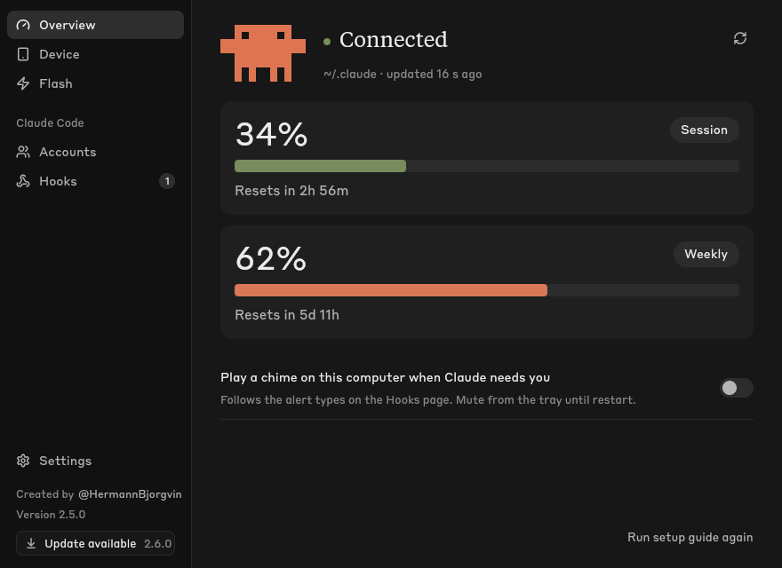</td>
    <td width="50%">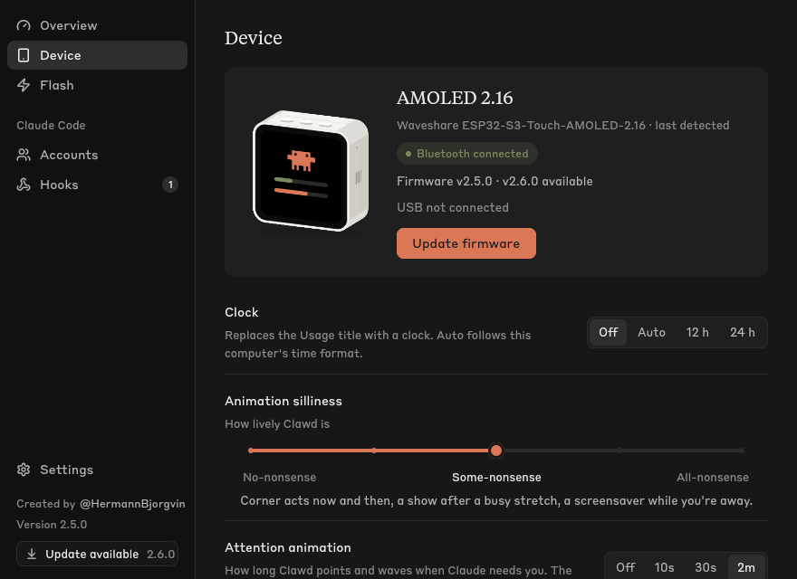</td>
  </tr>
</table>
<p align="center"><sub>Clawdmeter desktop app for flashing and configuring your board</sub></p>

---

<a href="https://github.com/notaharness/n10">
  <picture>
    <source media="(prefers-color-scheme: dark)" srcset="docs/images/n10-ad-dark.png">
    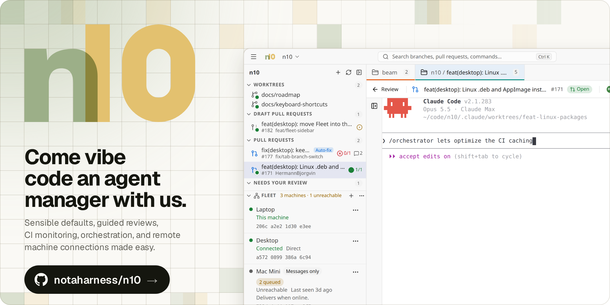
  </picture>
</a>

## Other supported boards

### Stable

Supported on every release.

|                                                                                                        | Board                                                                                                           |                                                                                               |
| :----------------------------------------------------------------------------------------------------: | --------------------------------------------------------------------------------------------------------------- | --------------------------------------------------------------------------------------------- |
|  | [Waveshare ESP32-C6-Touch-AMOLED-2.16](https://www.waveshare.com/esp32-c6-touch-amoled-2.16.htm?&aff_id=149786) | 480×480 AMOLED on the ESP32-C6, speaker. No PSRAM: animated corner Clawd, no full-size attention animation. |
|   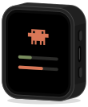   | [Waveshare ESP32-S3-Touch-AMOLED-1.8](https://www.waveshare.com/esp32-s3-touch-amoled-1.8.htm?&aff_id=149786)   | 368×448 AMOLED, 2 buttons, speaker.                                                           |
|   | [Waveshare ESP32-C6-Touch-AMOLED-1.8](https://www.waveshare.com/esp32-c6-touch-amoled-1.8.htm?&aff_id=149786)   | 368×448 AMOLED on the ESP32-C6.                                                               |
|  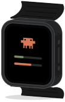   | [Waveshare ESP32-S3-Touch-AMOLED-2.06](https://www.waveshare.com/esp32-s3-touch-amoled-2.06.htm?&aff_id=149786) | 410×502 AMOLED in a watch case.                                                               |
|    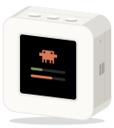    | [Waveshare ESP32-S3-Touch-LCD-1.54](https://www.waveshare.com/esp32-s3-lcd-1.54.htm?sku=33869&aff_id=149786)    | 240×240 IPS, 3 buttons, speaker. Smallest supported display.                                  |
| 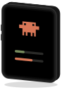 | [LILYGO T4-S3](https://lilygo.cc/products/t4-s3) | 450×600 AMOLED, one button (BOOT; long-hold cycles brightness / scene). |

### Experimental

Ports contributed by the community. Expect rough edges: bugs, or a layout
that isn't optimal for the panel. If something is off, fix it and open a PR.
If everything works, tell us in the
[Board support reports](https://github.com/HermannBjorgvin/Clawdmeter/discussions/222)
discussion (env name, firmware version, a photo) and we'll move the board to
Stable.

|                                                                                                        | Board                                                                                                           |                                                                                               |
| :----------------------------------------------------------------------------------------------------: | --------------------------------------------------------------------------------------------------------------- | --------------------------------------------------------------------------------------------- |
| 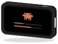 | [Waveshare ESP32-S3-Touch-LCD-1.47](https://www.waveshare.com/esp32-s3-touch-lcd-1.47.htm?&aff_id=149786) | 172×320 SPI TFT run as a 320×172 landscape strip. BOOT is the only button (PWR role); no HID buttons. |
|  | [Waveshare ESP32-C6-Touch-LCD-1.47](https://www.waveshare.com/esp32-c6-touch-lcd-1.47.htm?&aff_id=149786) | 172×320 SPI TFT run as a 320×172 landscape strip on the ESP32-C6 (no PSRAM). BOOT is the only button (PWR role); no HID buttons. |
| 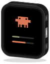 | [Waveshare ESP32-S3-Touch-LCD-1.83](https://www.waveshare.com/esp32-s3-touch-lcd-1.83.htm?&aff_id=149786) | 240×284 IPS SPI TFT, BOOT + PWR buttons, rounded watch-style case. |
| 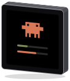 | [Guition ESP32-S3-4848S040 (4-inch 480×480)](https://www.aliexpress.com/item/3256806115962222.html) | 480×480 ST7701S RGB panel, GT911 touch, no buttons. Pair from the computer. |
| 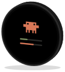 | [Waveshare ESP32-S3-Touch-AMOLED-1.43](https://www.waveshare.com/esp32-s3-touch-amoled-1.43.htm?&aff_id=149786) | 466×466 round AMOLED. BOOT is the only button (push-to-talk); pair by touch hold. |
| 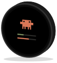 | [Waveshare ESP32-S3-Touch-AMOLED-1.32](https://www.waveshare.com/esp32-s3-touch-amoled-1.32.htm?&aff_id=149786) | 466×466 round AMOLED. BOOT rotates the UI; no HID buttons. |
| 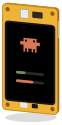 | [ESP32-2432S024C Cheap Yellow Display (portrait)](https://www.amazon.com/dp/B0CLGD2DG6) | 240×320 ST7789, CST820 capacitive touch, classic ESP32 without PSRAM. One button (BOOT = PWR role: brightness, hold to pair). Env `esp32_2432s024c` (portrait) or `esp32_2432s024c_landscape` (320×240). |
| 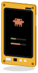 | [ESP32-2432S028R "Cheap Yellow Display"](https://www.amazon.com/dp/B0BVFXR313) | 240×320 ILI9341, XPT2046 resistive touch, classic ESP32 without PSRAM. One button (BOOT = PWR role: brightness, hold to pair). Env `esp32_2432s028r` (portrait) or `esp32_2432s028r_landscape` (320×240). |
| 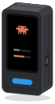 | [M5Stack M5StickS3](https://shop.m5stack.com/products/m5sticks3-esp32s3-mini-iot-dev-kit) | 135×240 ST7789P3 stick, no touch, speaker. BtnA is Space/voice, BtnB is PWR. |
| 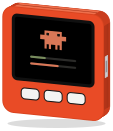 | [M5Stack FIRE IoT Development Kit (PSRAM) V2.7](https://shop.m5stack.com/products/m5stack-fire-iot-development-kit-psram-v2-7) | 320×240 IPS, classic ESP32 with PSRAM, no touch screen: A = Space, C = Shift+Tab, B = PWR (brightness, hold to pair). |
| 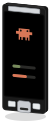 | [LILYGO T-Display S3](https://lilygo.cc/products/t-display-s3) | 170×320 IPS TFT, no touch. BOOT is push-to-talk, the second button (IO14) is the PWR role. |
| 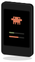 | [Waveshare ESP32-S3-Touch-LCD-2](https://www.waveshare.com/esp32-s3-touch-lcd-2.htm?&aff_id=149786) | 240×320 IPS, 2 inches, touch-only (no usable buttons). |
| 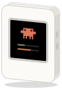 | [Waveshare ESP32-S3-ePaper-1.54](https://www.waveshare.com/esp32-s3-epaper-1.54.htm?&aff_id=149786) | 200×200 black-and-white e-paper, no touch. Minimal UI, slow partial refresh. |
| 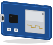 | [Xingzhi Cube 1.83 inch TFT WiFi (2-mic)](https://www.aliexpress.com/item/1005010442374066.html) | 284×240 landscape TFT, no touch, 3 buttons. Vendor init table on the ST7789 driver. |
| 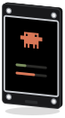 | [Freenove ESP32-S3 Display 2.8 inch (non-touch, FNK0104A)](https://store.freenove.com/products/fnk0104) | 240×320 IPS, no touch. Minimal UI: meters and a still Clawd; BOOT: brightness, hold to pair. |
| 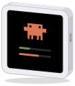 | [Seeed Studio SenseCAP Indicator D1L](https://www.seeedstudio.com/SenseCAP-Indicator-D1L-p-5646.html) | 480×480 RGB touch screen. Side button: brightness / hold to pair; no HID buttons or sound. |
| 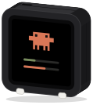 | [SpotPear ESP32-S3-LCD-1.54 MUMA (touch)](https://spotpear.com/shop/ESP32-S3-AI-1.54-inch-LCD-Display-TouchScreen-N16R8-muma-DeepSeek.html) | 240×240 ST7789 SPI LCD, CST816 touch, no PMU. BOOT is the only button. |
| 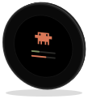 | [Waveshare ESP32-S3-Touch-LCD-2.1](https://www.waveshare.com/esp32-s3-touch-lcd-2.1.htm?aff_id=149786) | 480×480 round ST7701S RGB panel (flat 2.1 or curved-glass 2.1B), CST820 touch, battery gauge, alert beeps. BOOT is the only button; pair by touch hold. |
| 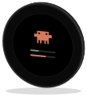 | [Waveshare ESP32-S3-Touch-LCD-2.8C](https://www.waveshare.com/esp32-s3-touch-lcd-2.8c.htm?sku=29086&aff_id=149786) | 480×480 round ST7701S RGB panel, GT911 touch, battery gauge, alert beeps. BOOT is the only button; pair by touch hold. Buy the touch version - the plain 2.8C will not work. |
| 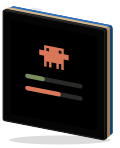 | [Waveshare ESP32-S3-Touch-LCD-4](https://www.waveshare.com/esp32-s3-touch-lcd-4.htm?&aff_id=149786) | 480×480 IPS, 4 inches, one button. V4.0 boards (CH32V003 IO expander) add alert beeps; battery level and brightness steps need a build with `BOARD_HAS_BATTERY 1` and a cell fitted. With a cell, plugging or unplugging USB resets the board. |
| 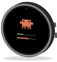 | [Waveshare ESP32-S3-Touch-AMOLED-1.75C](https://www.waveshare.com/esp32-s3-touch-amoled-1.75c.htm?aff_id=149786) | 466×466 round AMOLED, BOOT and PWR buttons, speaker. |

## Docs

- [User guide](docs/user-guide.md): setup, device controls, settings, and connection help.
- [Development](docs/development.md): builds, simulator, and releases.
- [Add a board](docs/porting/adding-a-board.md): hardware ports and app integration.
- [BLE protocol](docs/protocol.md): payload fields and notifications.
- [Clawd's director](docs/clawd-director.md): behavior and character rules.
- [ASCII pets](docs/pets.md): the pet build of the firmware.
- [Legacy daemon parity](docs/daemon-parity.md): upgrade steps and implementation differences.

## Licensing gray area warning

The software in this repository uses and adheres to the Anthropic brand guidelines and uses the same proprietary fonts that Anthropic has a license for but this software uses without permission as well as using assets from Anthropic such as the copyrighted Clawd mascot so even though the code in this repo is non-proprietary I will not license it myself under a copyleft license since this repo includes proprietary fonts and copyrighted assets. Please be aware of this if you fork or copy the code from this repo. **You have been warned!**
