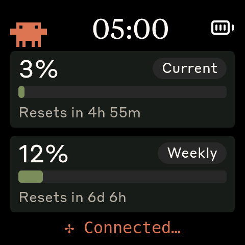
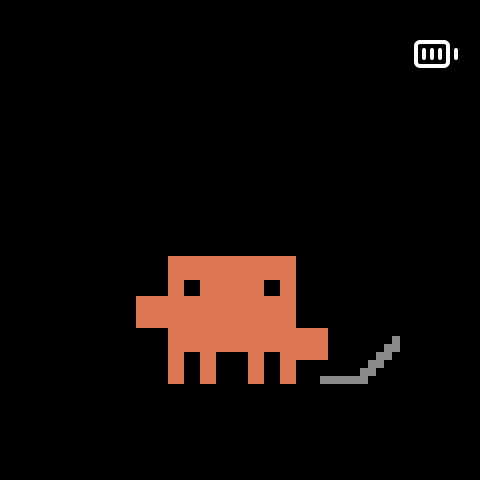

# User guide

You need a supported board, a USB data cable, Bluetooth, and Claude Code
installed and signed in to an account that reports usage limits.
See the [supported boards](../README.md#supported-boards).

## Installation

Download the installer for your OS from the [latest release](https://github.com/HermannBjorgvin/Clawdmeter/releases/latest).
The macOS and Windows packages are not signed with a publisher certificate.

| OS | File | Install |
| --- | --- | --- |
| macOS | `clawdmeter-<version>-macos-universal.dmg` | Open it and drag **Clawdmeter** to **Applications**. The first launch is blocked: open **System Settings → Privacy & Security**, click **Open Anyway**, then allow Bluetooth access. |
| Windows | `clawdmeter-<version>-windows-x86_64.msi` | Run it. If SmartScreen stops it, click **More info → Run anyway**. Installs for your user only (no admin) with a Start Menu entry; newer versions upgrade in place. |
| Debian, Ubuntu | `clawdmeter_<version>_amd64.deb` | `sudo apt install ./clawdmeter_<version>_amd64.deb` |
| Other Linux | `clawdmeter-<version>-x86_64.AppImage` | `chmod +x clawdmeter-*.AppImage` and run it. Keep it in one place: Start at login opens the file. The Claude Code hooks run a copy of its binary in `~/.config/clawdmeter/appimage/`, renewed when the AppImage changes. |
| NixOS, Nix | — | `nix run github:HermannBjorgvin/Clawdmeter`, or see [Nix](#nix). |

Portable archives (`.tar.gz` for Linux and macOS, `.zip` for Windows) are on
the same release if you'd rather not install anything.

On Linux, Bluetooth needs BlueZ and a D-Bus session, and GPUI needs working
Vulkan drivers. The tray needs a StatusNotifierItem host; GNOME needs the
AppIndicator extension.

### Nix

The flake builds the app for `x86_64-linux` and `aarch64-linux`. To keep it
installed on NixOS or with home-manager, add the flake as an input and the
package to your packages:

```nix
# flake.nix
inputs.clawdmeter.url = "github:HermannBjorgvin/Clawdmeter";

# NixOS module
environment.systemPackages = [ inputs.clawdmeter.packages.${pkgs.stdenv.hostPlatform.system}.default ];
# or home-manager
home.packages = [ inputs.clawdmeter.packages.${pkgs.stdenv.hostPlatform.system}.default ];
```

Vulkan comes from the system (`hardware.graphics.enable = true`) and
Bluetooth from `hardware.bluetooth.enable = true`. The app writes its own
`/nix/store` path into the Claude Code hooks and the autostart entry, so
reinstall the hooks from the **Hooks** page and toggle **Start at login** after
an upgrade. `nix develop` gives a shell with Rust, PlatformIO and the Linux
libraries.

Launch Clawdmeter to open setup. It stays in the tray or macOS menu bar.
Without a tray, it uses a window; closing that window quits the app.
You can skip setup and return through **Run setup again** in Settings.

## Install firmware

Connect the board over USB and follow setup, or open **Flash**. The app
identifies the chip, asks you to choose a board when needed, downloads the
matching firmware, and verifies its checksum before writing. Check the
board selection before starting. Keep the cable connected during the write.

A firmware update preserves Bluetooth pairing. If the board already runs
the latest release, you can continue without writing it again. On Linux,
the flasher reports serial-port permission problems and how to resolve them.


For a browser-based flash, download the board's merged `<env>-<version>.bin`
from the release. In Chrome or Edge, open [Espressif's web flasher](https://espressif.github.io/esptool-js/),
connect the board, select the image at address `0x0`, and choose **Program**.

## Pair over Bluetooth

Pair **Clawdmeter** in your computer's Bluetooth settings. It appears as a
keyboard because its buttons send key presses.

- Linux: use the desktop Bluetooth settings, or run `bluetoothctl`, then
  `scan on`, `pair <MAC>`, and `trust <MAC>`.
- macOS: System Settings → Bluetooth → **Connect** next to Clawdmeter.
- Windows: Settings → Bluetooth & devices → Add device → Bluetooth → Clawdmeter.

For normal operation, the app looks for an OS-known Clawdmeter rather than
connecting to arbitrary nearby devices. On boards with a software-controlled
PWR button, hold it for about 3 seconds, then release to clear the device's
Bluetooth bonds. The LCD-4's PWR key resets the board; it does not clear pairing.

## Hooks and privacy

Open **Hooks**, select the accounts to update, and review the changes to
`settings.json` before saving. Changes Claude Code makes to the file while
the review is open are kept. The first time a file is changed, the original
is saved as `settings.json.bak`; later changes keep that backup. Other hooks
remain in place. On macOS, move Clawdmeter to Applications before setting up
hooks or Start at login; on Windows, extract it from the zip first.

Hooks let Clawd react to activity and show alerts. The local event log
contains timestamps, event types, and session IDs. Alerts also store the
notification message or the first question from `AskUserQuestion`, which
is sent to the device. Prompt text and full tool-call payloads are not
written to the event log.

Usage meters work without hooks. Use **Send a test alert** to check the
app-to-device alert path; it does not test whether Claude Code invoked a hook.

## Start at login

Enable **Settings → Start at login** to launch the tray app when you sign in.
The app uses XDG autostart on Linux, a LaunchAgent on macOS, and a user Run
entry on Windows.

## On the device

| Meters | Show | Screensaver | Attention |
| --- | --- | --- | --- |
|  |  |  |  |
| Session and weekly usage | After sustained activity | After a quiet stretch | A session needs an answer |

The device boots to the meters. Tap a show or screensaver to return to them.
Tap the meters to bring Clawd's face up to the glass; tap again to send him
back. A tap that wakes a sleeping panel only wakes it.

The device names what the session is waiting for in one short line:
**Question for you**, **Permission needed!**, **Waiting for you!** (an idle
prompt) or **MCP request!**. The test alert says **Clawdmeter test alert**.

A tap or the device's two-minute timeout dismisses the alert on the device
and tells the app to clear it from the tray too. Answering also clears the
alert through hooks. Uncleared app alerts expire after 2 minutes too; test
alerts expire after 30 seconds. C6 boards show the message without the
full-size Clawd. Optional alert and reset chimes work on boards with an implemented audio output; those boards also ding once when they start.
Boards with the **minimal display** capability keep the meters and a still
Clawd, with no animated scenes. This is a board capability, not a user setting.

The status line rotates through Claude Code's whimsical thinking verbs when
all is well. It shows **Waiting** without a connection, **No data** before a
reading, and **Stale** when the retained reading is old. The verbs are a
healthy-status indicator, not a report of an active model request. While
connected but waiting for fresh data, the status alternates with **Listening**. Minimal display uses fixed status text.

If updates stop, the meters dim. The last reading is retained rather than
replaced with zero. See [Clawd's director](clawd-director.md) for timing
and character rules.

### Buttons

| Button | Action |
| --- | --- |
| BOOT | Hold to send Space to the focused window, for Claude Code voice input. GPIO 0 on S3; GPIO 9 on C6. |
| Secondary, where fitted | Send Shift+Tab to the focused window. S3 2.16: GPIO 18; C6 2.16: GPIO 10; LCD-1.54: GPIO 5. |
| PWR, where software-controlled | Short press: next scene on the stage, brightness elsewhere. Hold about 3 seconds and release: clear pairing. |

The LCD-4 has one user button, BOOT. Its PWR key is a hardware reset.

## Settings and files

On Linux and macOS, config and state live in `~/.config/clawdmeter/`.
On Windows, they live in `%LOCALAPPDATA%\Clawdmeter\`.
The config file is `~/.config/clawdmeter/config` on Linux and macOS, or
`%LOCALAPPDATA%\Clawdmeter\config` on Windows. It uses `key = value` lines. The app reloads it every few
seconds and preserves comments and unknown keys when saving.

| Key | Default | Effect |
| --- | --- | --- |
| `config_dirs` | `~/.claude` | Comma-separated Claude Code config folders. The app selects the account whose session usage increased most recently. `CLAUDE_CONFIG_DIR` supplies the default when this key is absent. |
| `reset_chime` | `off` | Chime on the device when the session usage resets (boards with a speaker). The older `chime` key still works. |
| `alert_chime` | `off` | Chime on the device when Claude needs you (boards with a speaker). The older `beep` key still works. |
| `desktop_chime` | `off` | Play the same chime on this computer when Claude needs you. Follows `alert_on`. |
| `clock` | `off` | `auto`, `12`, or `24` replaces the device's Usage title with a clock. |
| `poll_interval` | automatic | Override working and no-hooks polling intervals, in seconds. The scheduler enforces at least 120 seconds per account. Quiet and other-account schedules still apply. |
| `heartbeat_interval` | `60` | Resend cached readings between usage checks. This does not fetch usage. Keep the default unless diagnosing the connection. |
| `claude_path` | found on `PATH` | Full path to the Claude Code executable, if detection fails. |
| `update_check` | `on` | Check for firmware releases daily. |
| `alert_on` | `permission, question, elicitation` | Which waits alert on the device and tray: `permission`, `question`, `idle`, `elicitation` (MCP input), or `none`. Set on the Hooks page. Other notification types follow `permission`. |
| `release_repo` | `HermannBjorgvin/Clawdmeter` | GitHub repository used for firmware releases. |
| `onboarding_done` | unset | `true` after setup is finished or skipped. |

**Mute chimes** in the tray silences the alert chime and the desktop chime
until the app restarts.

The tray app writes `daemon.log` in the state folder and keeps the previous
run as `daemon.log.1`. **Settings** links to the log and config file.

### Refresh timing

Two sources are used per account:

- **While the account's 5-hour session is running**, Clawdmeter has Claude
  Code send one short Haiku message (no tools, hooks, MCP servers or saved
  session) and reads the usage from its rate-limit headers.
- **Otherwise**, it asks Claude's usage endpoint
  (`api.anthropic.com/api/oauth/usage`) with the sign-in Claude Code already
  stored (the macOS Keychain, or `.credentials.json` in the account folder).
  Clawdmeter only reads that token; it never refreshes it. When it has
  expired or is refused, Clawdmeter runs `claude -p /usage` instead, which
  renews it and sends no message. A rate-limited answer pauses that
  account's checks until exactly when the server says, across restarts and
  whatever asks (Refresh now included), because asking during the pause
  makes it longer; the app shows "Usage paused by Anthropic until HH:MM".
  Other misses retry after 10, 20, then 30 minutes. Without any readable
  sign-in it falls back to `claude -p /usage`.

Sending a message starts a session when none is running, so the message is
only sent while a session is known to be running: its last known reset is
more than 5 minutes away, or your own prompt or tool use in that account
started one (the hooks tell which account a session belongs to). When a
session ends with no activity since, the device shows it as not started
without asking at all.

With a session running, the shown account is checked after a prompt, every 3
minutes while working, and about 10 seconds after a turn stops. Checks fall
to every 5 minutes during the first 10 quiet minutes, then every 15 minutes.
Without hooks, checks run every 5 minutes. Other accounts are checked every
10 minutes. With no session known to be running, `/usage` checks each account
every 12 minutes.

Claude Code is found through `claude_path`, then `PATH` and the usual install
folders, then the copy the Claude desktop app downloads for itself (the newest
version under its `claude-code` folder: `~/.config/Claude/claude-code` on
Linux, verified; `~/Library/Application Support/Claude/claude-code` on macOS
and `%APPDATA%\Claude\claude-code` on Windows, from the desktop app's code).
Settings → Advanced and the Accounts page say which one is in use. Without
Claude Code, usage still updates every 12 minutes from the usage endpoint.

Every trigger, including manual refresh, respects a two-minute minimum gap
and any retry delay. Transient failures delay retries by 10, 20, then 30
minutes. A failed check never becomes a zero reading. Heartbeats stop once
the selected reading is stale, allowing the device to show the loss of fresh data.

### Command line

```text
clawdmeter                      Run the tray app
clawdmeter --daemon             Run without a tray or window
clawdmeter --once               Read usage once and print the payload; no Bluetooth
clawdmeter --window [PAGE]       Open overview, device, flash, accounts, hooks, settings, or setup
clawdmeter --ports              List attached Espressif USB ports
clawdmeter --info PORT          Read the board and firmware version over USB
clawdmeter hook MODE [event]    Handle a Claude Code hook: alert, clear, or event
```

`CLAWDMETER_LOG=debug` enables debug logs. `CLAWDMETER_NO_TRAY=1` uses a
window instead of a tray icon. `CLAWDMETER_BLE_ADDRESS` selects the paired
device address to try first.

## Connection help

- **No tray icon on Linux:** check that your desktop has a StatusNotifierItem
  host. GNOME needs the AppIndicator extension. Set `CLAWDMETER_NO_TRAY=1`
  to use a window instead.
- **Cannot write firmware:** check the USB data cable and follow the Flash
  page's serial-port permission instructions.
- **Cannot reconnect:** check pairing in your OS's Bluetooth settings.
  On the LCD-4, hold the pairing hint on the touchscreen for five seconds
  to clear pairing; its PWR key is a hardware reset.
- **Usage stops updating:** check Accounts for a login problem or retry
  delay. Manual refresh respects the same delay; see [refresh timing](#refresh-timing).
  Settings links to the log file.

If you used a bash or Python daemon, follow the
[replacement steps](daemon-parity.md#replacing-a-legacy-daemon).
