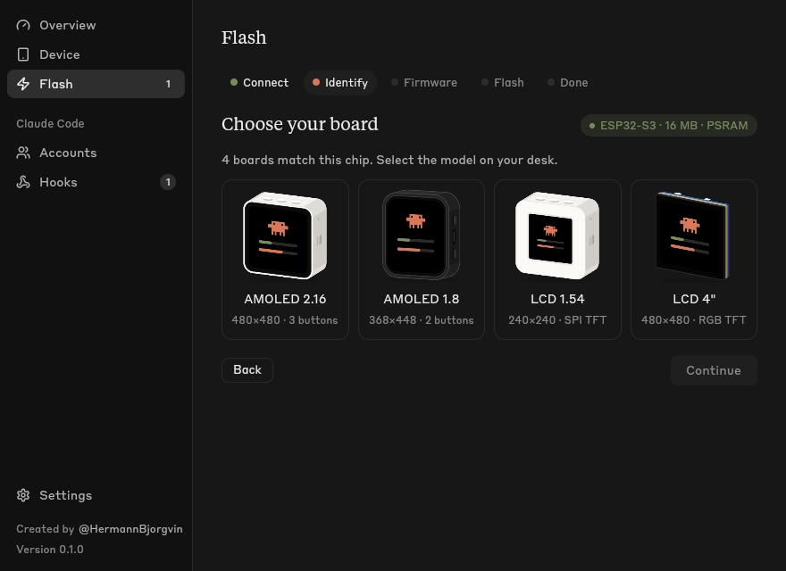
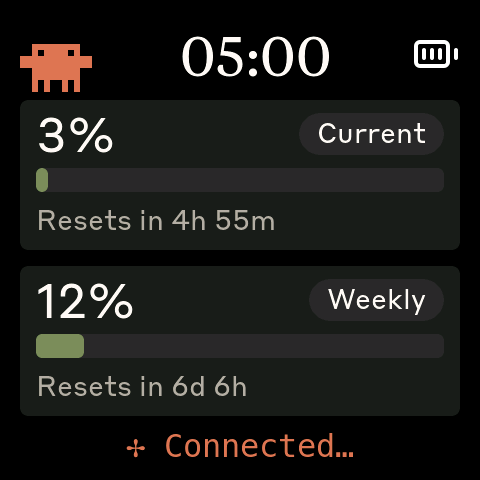
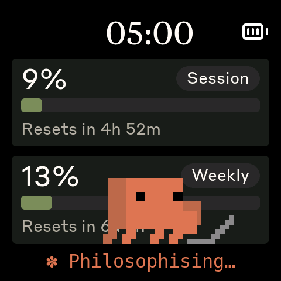
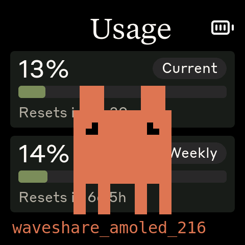

# User guide

You need a supported board, a USB data cable, Bluetooth, and Claude Code
installed and signed in to an account that reports usage limits.
See the [supported boards](../README.md#supported-boards).

## Installation

Download the installer for your OS from the [latest release](https://github.com/HermannBjorgvin/Clawdmeter/releases/latest).
The macOS and Windows packages are not signed with a publisher certificate.

| OS | File | Install |
| --- | --- | --- |
| macOS | `clawdmeter-<version>-macos-universal.dmg` | Open it and drag **Clawdmeter** to **Applications**. The first launch is blocked: open **System Settings → Privacy & Security**, click **Open Anyway**, then allow Bluetooth access. |
| Windows | `clawdmeter-<version>-windows-x86_64.msi` | Run it. If SmartScreen stops it, click **More info → Run anyway**. Installs for your user only (no admin) with a Start Menu entry; newer versions upgrade in place. |
| Debian, Ubuntu | `clawdmeter_<version>_amd64.deb` | `sudo apt install ./clawdmeter_<version>_amd64.deb` |
| Other Linux | `clawdmeter-<version>-x86_64.AppImage` | `chmod +x clawdmeter-*.AppImage` and run it. Keep it in one place: Start at login opens the file. The Claude Code hooks run a copy of its binary in `~/.config/clawdmeter/appimage/`, renewed when the AppImage changes. |
| NixOS, Nix | — | `nix run github:HermannBjorgvin/Clawdmeter`, or see [Nix](#nix). |

Portable archives (`.tar.gz` for Linux and macOS, `.zip` for Windows) are on
the same release if you'd rather not install anything.

On Linux, Bluetooth needs BlueZ and a D-Bus session, and GPUI needs working
Vulkan drivers. The tray needs a StatusNotifierItem host; GNOME needs the
AppIndicator extension.

### Nix

The flake builds the app for `x86_64-linux` and `aarch64-linux`. To keep it
installed on NixOS or with home-manager, add the flake as an input and the
package to your packages:

```nix
# flake.nix
inputs.clawdmeter.url = "github:HermannBjorgvin/Clawdmeter";

# NixOS module
environment.systemPackages = [ inputs.clawdmeter.packages.${pkgs.stdenv.hostPlatform.system}.default ];
# or home-manager
home.packages = [ inputs.clawdmeter.packages.${pkgs.stdenv.hostPlatform.system}.default ];
```

Vulkan comes from the system (`hardware.graphics.enable = true`) and
Bluetooth from `hardware.bluetooth.enable = true`. The app writes its own
`/nix/store` path into the Claude Code hooks and the autostart entry, so
reinstall the hooks from the **Hooks** page and toggle **Start at login** after
an upgrade. `nix develop` gives a shell with Rust, PlatformIO and the Linux
libraries.

Launch Clawdmeter to open setup. It stays in the tray or macOS menu bar.
Its menu shows what the device shows: the link, the account, and each usage
meter with its reset countdown (one **Spend** meter on a spend-capped
account). On macOS the top of the menu draws them as on
the device, with Clawd and the bars (and the pace marker when it's on), and
**Show usage in the menu bar** in Settings puts the higher of the session
and weekly percentages beside the icon. The reload button in the corner of
the macOS menu checks usage now and keeps the menu open while it does; it's
dimmed while a check can't run yet (its tooltip says when it can). The
bottom row has **Open Clawdmeter** and, on the right, an update icon with an
orange dot while a newer release is out (it opens **Update** to install the
new app first, then **Flash** for the board's firmware; skip the app's
release and it stays hidden until the next one), a speaker
that turns the chime on this computer on or off (the Overview's **Play a
chime on this computer** switch), Settings, and a power icon that quits.
The board's own alert chime isn't in the tray menu: switch it with **Alert
chime** on the Device page. On Linux and Windows the menu lists **Refresh
usage** (greyed out, saying when it can check again, until a check can run),
**Chime on this computer** (checked while the Overview's switch is on;
clicking it flips that switch), **Open Clawdmeter**, **Settings…**,
**Update Clawdmeter to v…** or **Update firmware to v…** and **Quit
Clawdmeter** instead, with the same conditions. With the pace marker on,
their usage rows end with the marker's verdict: *on pace*, *ahead of pace*
or *at the limit*.
Without a tray, it uses a window; closing that window quits the app.
You can skip setup and return through **Run setup again** in Settings.

## Install firmware

Connect the board over USB and follow setup, or open **Flash**. The app
identifies the chip, asks you to choose a board when needed, downloads the
matching firmware, and verifies its checksum before writing. Check the
board selection before starting. Keep the cable connected during the write.

A firmware update preserves Bluetooth pairing. If the board already runs
the latest release, you can continue without writing it again. On Linux,
the flasher reports serial-port permission problems and how to resolve them.



For a browser-based flash, download the board's merged `<env>-<version>.bin`
from the release. In Chrome or Edge, open [Espressif's web flasher](https://espressif.github.io/esptool-js/),
connect the board, select the image at address `0x0`, and choose **Program**.

## Pair over Bluetooth

Pair **Clawdmeter** in your computer's Bluetooth settings. It appears as a
keyboard because its buttons send key presses.

- Linux: use the desktop Bluetooth settings, or run `bluetoothctl`, then
  `scan on`, `pair <MAC>`, and `trust <MAC>`.
- macOS: System Settings → Bluetooth → **Connect** next to Clawdmeter.
- Windows: Settings → Bluetooth & devices → Add device → Bluetooth → Clawdmeter.

For normal operation, the app looks for an OS-known Clawdmeter rather than
connecting to arbitrary nearby devices. On boards with a software-controlled
PWR button, hold it for about 3 seconds, then release to clear the device's
Bluetooth bonds. The LCD-4's PWR key resets the board; it does not clear pairing.

## Hooks and privacy

Open **Hooks**, select the accounts to update, and review the changes to
`settings.json` before saving. Changes Claude Code makes to the file while
the review is open are kept. The first time a file is changed, the original
is saved as `settings.json.bak`; later changes keep that backup. Other hooks
remain in place. On macOS, move Clawdmeter to Applications before setting up
hooks or Start at login; on Windows, extract it from the zip first.

Hooks let Clawd react to activity and show alerts. The local event log
contains timestamps, event types, and session IDs. Alerts also store the
notification message or the first question from `AskUserQuestion`, which
is sent to the device, and the name of the session's working directory,
which the device shows so you know which session is waiting (`alert_project`).
Prompt text and full tool-call payloads are not written to the event log.

Usage meters work without hooks. Use **Send a test alert** to check the
app-to-device alert path; it does not test whether Claude Code invoked a hook.

## Start at login

Enable **Settings → Start at login** to launch the tray app when you sign in.
The app uses XDG autostart on Linux, a LaunchAgent on macOS, and a user Run
entry on Windows.

## On the device

| Meters | Show | Screensaver | Attention |
| --- | --- | --- | --- |
|  |  |  |  |
| Session and weekly usage | After sustained activity | After a quiet stretch | A session needs an answer |

**Animation silliness** on the Device page sets how lively Clawd is. **No-nonsense**
keeps him still in his corner: no shows, no screensaver, no idle acts or
reactions, and the status line changes its word once a minute with a still
spinner. Taps and alerts still get their reaction. **Some-nonsense** (the
default) is the behaviour described here. **All-nonsense** earns shows
sooner, on lighter work, and has him act up far more often. A line under
the slider says what the chosen level does. **Attention animation** sets how
long he points and waves when Claude needs you (off, 10 or 30 seconds, or 2
minutes, the default); the alert itself stays up until you tap it either
way. The device remembers these settings across restarts.

**Pace marker** puts a thin line on the session and weekly bars at how far
into each window you are: 3 hours before the session resets, 40% of it has
gone, so the line sits at 40%. The bar is green while usage is at or behind
the line, amber when it's ahead, and red at the limit. Off (the default),
the bars go amber at 50% and red at 80%. A bar with no reset time yet keeps
those colours, and spend-capped accounts are unchanged.

**Colors** sets the board's palette. **System theme**, the default, follows
this computer's light or dark mode: the board shows **Dark** (its own
palette) or **Light** and switches within a couple of seconds when the mode
changes, while usage is current (with stale numbers it waits for the next
reading). **Solarized** does the same between **Solarized Dark** and
**Solarized Light**.
Pick Dark, Light or another theme to keep one palette, or **Custom +** to
choose each colour. The e-paper board stays black on white whatever is
chosen. A setup that makes things dark only through `GTK_THEME` (common on
tiling window managers) and leaves the desktop's colour scheme at its
default gets the Light board with System theme or Solarized: pick Dark or
Solarized Dark there.

Accounts with no 5-hour limit, such as Ultra (formerly Max 20x) once
Anthropic has verified the account, show only the **Weekly** meter on the
device, the Overview page and the tray. Clawdmeter goes by what the usage
server reports, not by the plan's name: an Ultra account that isn't verified
yet still has a temporary 5-hour limit and keeps the Session meter until the
limit goes. For these accounts the reset chime and Clawd's fresh-window jump
mark the weekly reset. Firmware older than this change keeps showing the
session as not started; update it from the Flash page.

Accounts with a Fable weekly limit get a purple strip at the left end of
the **Weekly** bar, on the device, the Overview page and the macOS tray
menu. The device draws it in the chosen theme's own purple (**Fable** under
**Custom +**); the Overview and the tray, like their other meters, use the
Dark or Light theme's, whichever matches your computer's light or dark
appearance. Fable's limit is half the weekly limit, so the strip grows to the middle of the
bar as Fable is used: when it reaches the middle, Fable is used up for the
week, while the rest of the bar still shows the overall weekly usage. Its
right end is straight; it never runs past the weekly fill, and it fills
all of it when Fable is all you used (within a point and a half, since the
two numbers are rounded separately). On the device it waits until the fill
is wider than its rounded ends. While you work through a 5-hour window the
quick usage check rarely reports Fable, so the strip can trail the weekly
fill until the next full usage reading, near the end of that window at the
latest. With no Fable reading yet there's no strip. The e-paper board
doesn't draw it.

On an account with no 5-hour limit, the second card is free, so Fable gets
it in place of the strip: a **Fable** card with Fable's percentage of its
own limit, a bar in the Fable colour (full at 100 % and past it) and the
week's reset countdown. With no Fable reading the Weekly card sits alone,
as before.

**Codex accounts (a trial).** With the Codex CLI signed in to ChatGPT, its
folder (`~/.codex`, or `$CODEX_HOME`) is picked up as an account on its own;
the Accounts page's **Add account folder…** takes other Codex folders too (a
folder with an `auth.json` is Codex, anything else Claude Code). A Codex
account is shown once its own usage rises and stays until another account's
does; until then a Claude account comes first, whatever the percentages. The
device then draws white bars with a **Codex** pill and, on a weekly-only plan
such as the $100 Pro plan, a **Resets expire** card: the count of reset
credits still held beside a ticket, and each one's expiry date, soonest
first and highlighted (up to six on the largest panels; past that, "+N
more"). The Overview shows the same card, the macOS menu-bar panel a row of
up to four dates under the meter, and the Linux and Windows tray menus one
line, such as "3 resets · next expires Nov 30". Clawd stays as he is: his
reactions follow Claude Code's hooks, and Codex numbers don't touch his mood
or the reset chime. With no Codex folder, nothing about Codex is polled or
shown beyond the trial note on the Accounts page.

The device boots to the meters. Clawd performs his shows right on them,
in front of the panels. Tap a show or the screensaver to send him back to
his seat.
Tap the meters to bring Clawd's face up to the glass; tap again to send him
back. A tap that wakes a sleeping panel only wakes it.

The device names what the session is waiting for, and which project it is
in, in one short line: **Question: my-project**, **Permission: my-project**,
**Waiting: my-project** (an idle prompt) or **MCP: my-project**. Without a
project (or with `alert_project = off`) it reads **Question for you**,
**Permission needed!**, **Waiting for you!** or **MCP request!**. The test alert says **Clawdmeter test alert**.

A tap or the device's two-minute timeout dismisses the alert on the device
and tells the app to clear it from the tray too. Answering also clears the
alert through hooks. Uncleared app alerts expire after 2 minutes too; test
alerts expire after 30 seconds. C6 boards show the message without the
full-size Clawd. Optional alert and reset chimes work on boards with an implemented audio output; boards with a speaker also ding once when they start. Boards with a plain on/off buzzer (LCD-4 V4.0, LCD-2.1, LCD-2.8C) can't play the ding: they beep three times instead, and once when they start.
Boards with the **minimal display** capability keep the meters and a still
Clawd, with no animated scenes. This is a board capability, not a user setting.
C6 boards have no room for the full-size Clawd: their shows are acts in his
corner seat.

The status line rotates through Claude Code's whimsical thinking verbs when
all is well. It shows **Waiting** without a connection, **No data** before a
reading, and **Stale** when the retained reading is old. The verbs are a
healthy-status indicator, not a report of an active model request. While
connected but waiting for fresh data, the status alternates with **Listening**. Minimal display uses fixed status text.

If updates stop, the meters dim (on the e-paper board they stay black and
the status line says **Stale**). The last reading is retained rather than
replaced with zero. See [Clawd's director](clawd-director.md) for timing
and character rules.

### Buttons

| Button | Action |
| --- | --- |
| BOOT | By default, hold to send Space to the focused window, for Claude Code voice input. GPIO 0 on S3; GPIO 9 on C6. |
| Secondary, where fitted | By default, send Shift+Tab to the focused window. S3 2.16: GPIO 18; C6 2.16: GPIO 10; LCD-1.54: GPIO 5. |
| PWR, where software-controlled | Short press: by default, brightness. Hold about 3 seconds and release: clear pairing. |

Each button can do something else. **Controls** on the app's Device page
shows your board's buttons as keys, in the order they sit on it and under
their names there (on the 2.16: Left, PWR, Right), each with what it does.
Click one to change it:

- **Keys**: send Space, Shift+Tab, Tab, Enter or Esc. Space is held while you
  hold the button; the others are tapped once per press.
- **Media**: Play/Pause, Previous, Next, Volume down, Volume up or Mute.
  Volume repeats while you hold the button.
- **Other**: **Brightness** cycles the screen brightness, so a board without
  a PWR button can have one; **Nothing** leaves the button to wake the
  screen.
- **Shortcut**: a keyboard shortcut of your own. Click the shortcut field
  (or Record) and press the keys, such as Ctrl+Shift+M or Cmd+Shift+M for
  Teams mute, Alt+A for Zoom, or Win+Alt+K for the Windows 11 microphone.
  Escape is recorded like any other key; Cancel stops listening. Turn the
  Ctrl, Shift, Alt and Cmd/Win/Super switches on or off afterwards for
  shortcuts your system keeps to itself while recording. **Hold while
  pressed** keeps the keys down while you hold the button, for push to talk
  such as Teams' Ctrl+Space; otherwise they are tapped.

PWR can only tap: a short press registers when you let go, so it has no
Hold switch, and volume doesn't repeat on it. Holding PWR to clear the
pairing works whatever its action. On boards without a touchscreen, the
first press of BOOT (or of PWR, if it's the only button) during an alert
dismisses the alert instead.

The board sends key positions as on a US keyboard, and your computer reads
them with its own layout. The app records the character a key types and
sends the US key that types it, so recording is reliable on US-like layouts
(QWERTY with US punctuation). On others, such as AZERTY or QWERTZ, some
letters, digits and punctuation land on a different key: check the shortcut
after recording it. The app says so when a key can't be sent, such as a
letter that isn't on a US keyboard. Keypad digits are recorded as the digits
above the letters.

Media keys and F13–F24 came with a change to the board's Bluetooth keyboard
description. After updating from older firmware, the board tells your
computer when they next connect, so it reads the description again. If
media keys or F13–F24 still do nothing, your computer kept the old
description: forget Clawdmeter in your Bluetooth settings, clear the
board's pairing (hold PWR about 3 seconds and release, or **Clear the
board's pairing** on the Device page over USB) and pair it again. You only
need to do this once. After going back to older firmware and updating again,
re-pair the same way if the keys misbehave.

The LCD-4 has one user button, BOOT. Its PWR key is a hardware reset.

## Settings and files

On Linux and macOS, config and state live in `~/.config/clawdmeter/`.
On Windows, they live in `%LOCALAPPDATA%\Clawdmeter\`.
The config file is `~/.config/clawdmeter/config` on Linux and macOS, or
`%LOCALAPPDATA%\Clawdmeter\config` on Windows. It uses `key = value` lines. The app reloads it every few
seconds and preserves comments and unknown keys when saving.

| Key | Default | Effect |
| --- | --- | --- |
| `config_dirs` | `~/.claude` | Comma-separated Claude Code config folders. The app selects the account whose usage increased most recently (session usage, or weekly usage on an account with no 5-hour limit); before any rise, the one with the highest percentage. `CLAUDE_CONFIG_DIR` supplies the default when this key is absent. |
| `reset_chime` | `off` | Play a chime or buzzer on devices with supported hardware, when the session usage resets. The older `chime` key still works. |
| `alert_chime` | `off` | Play a chime or buzzer on devices with supported hardware, when Claude needs you. The older `beep` key still works. |
| `desktop_chime` | `off` | Play the same chime on this computer when Claude needs you. Follows `alert_on`. |
| `clock` | `off` | `auto`, `12`, or `24` replaces the device's Usage title with a clock. |
| `liveliness` | `3` | How lively Clawd is, `1` (No-nonsense) to `5` (All-nonsense). Set with **Animation silliness** on the Device page. |
| `attention_anim` | `2m` | How long Clawd points and waves for an alert: `off`, `10s`, `30s` or `2m`. The alert itself is unchanged. Set with **Attention animation** on the Device page. |
| `pace_marker` | `off` | `on` marks the elapsed share of each usage window on the device's bars and colours them by pace. Set with **Pace marker** on the Device page. |
| `menu_bar_usage` | `off` | macOS: `on` shows the higher of the session and weekly percentages beside the menu bar icon (spend, on a spend-capped account), so the limit closest to stopping you. Set with **Show usage in the menu bar** on the Settings page. |
| `theme` | `system` | The device's colours, Clawd's included: `system` (Dark or Light, following this computer's light or dark mode, and switching when it does; `clawd`, the old default, means the same), `dark` (the board's own palette), `light`, `catppuccin_mocha`, `dracula`, `gruvbox`, `monokai`, `nord`, `one_dark`, `solarized` (Solarized Dark or Light, following the mode like `system`), `solarized_dark`, `solarized_light`, `tokyo_night`, or `custom` for the `color_*` keys below. Set with **Colors** on the Device page. |
| `color_<name>` | the default palette | The custom theme's colours as `rrggbb` (no `#`, which starts a comment): `color_bg`, `color_panel`, `color_text`, `color_dim`, `color_accent`, `color_green`, `color_amber`, `color_red`, `color_bar_bg`, `color_clawd`, `color_eye`, `color_fable` (the Fable strip in the weekly bar). Used only with `theme = custom` and kept while a preset is chosen. Set with **Custom +** under **Colors** on the Device page (a swatch or a typed hex code). The first time, Custom starts from the theme you're on and writes all twelve keys; from then on it keeps its own colours. A custom theme saved before `color_fable` existed starts it at the Dark theme's violet. |
| `codex_dirs` | `~/.codex` when signed in | Comma-separated Codex folders (a trial). Absent: the Codex CLI's folder (`$CODEX_HOME`, else `~/.codex`) when it has an `auth.json`; empty: none. |
| `poll_interval` | automatic | Override working and no-hooks polling intervals, in seconds. The scheduler enforces at least 120 seconds per account. Quiet and other-account schedules still apply. |
| `heartbeat_interval` | `60` | Resend cached readings between usage checks. This does not fetch usage. Keep the default unless diagnosing the connection. |
| `claude_path` | found on `PATH` | Full path to the Claude Code executable, if detection fails. |
| `update_check` | `on` | Check for firmware and app releases daily. |
| `skipped_update` | unset | The app release you chose to skip, such as `v2.5.0`. The sidebar stops mentioning it; a later release is announced again. |
| `skipped_firmware` | unset | The firmware release you skipped on the Overview, such as `v2.5.0`. The Overview and the Flash item stop mentioning it; the Device page and the tray menu still offer it, and a later release is announced again. |
| `alert_project` | `on` | Name the session that is waiting in the device's alert line: `Permission: my-project` (the name of the session's working directory) in place of `Permission needed!`. `off` keeps the fixed lines. Alerts raised by hooks from before this setting carry no project and show the fixed line. |
| `alert_on` | `permission, question, elicitation` | Which waits alert on the device and tray: `permission`, `question`, `idle`, `elicitation` (MCP input), or `none`. Set on the Hooks page. Other notification types follow `permission`. |
| `release_repo` | `HermannBjorgvin/Clawdmeter` | GitHub repository used for firmware releases. |
| `onboarding_done` | unset | `true` after setup is finished or skipped. |


The tray app writes `daemon.log` in the state folder and keeps the previous
run as `daemon.log.1`. **Settings** links to the log and config file.

### Refresh timing

Two sources are used per account:

- **While the account's 5-hour session is running**, Clawdmeter has Claude
  Code send one short Haiku message (no tools, hooks, MCP servers or saved
  session) and reads the usage from its rate-limit headers.
- **Otherwise**, it asks Claude's usage endpoint
  (`api.anthropic.com/api/oauth/usage`) with the sign-in Claude Code already
  stored (the macOS Keychain, or `.credentials.json` in the account folder).
  Clawdmeter only reads that token; it never refreshes it. When it has
  expired or is refused, Clawdmeter runs `claude -p /usage` instead, which
  renews it and sends no message. A rate-limited answer pauses that
  account's checks until exactly when the server says, across restarts and
  whatever asks (Refresh now included), because asking during the pause
  makes it longer; the app shows "Usage paused by Anthropic until HH:MM".
  Other misses retry after 10, 20, then 30 minutes. Without any readable
  sign-in it falls back to `claude -p /usage`.

Sending a message starts a session when none is running, so the message is
only sent while a session is known to be running: its last known reset is
more than 5 minutes away, or your own prompt or tool use in that account
started one (the hooks tell which account a session belongs to). When a
session ends with no activity since, the device shows it as not started
without asking at all.

With a session running, the shown account is checked after a prompt, every 3
minutes while working, and about 10 seconds after a turn stops. Checks fall
to every 5 minutes during the first 10 quiet minutes, then every 15 minutes.
Without hooks, checks run every 5 minutes. Other accounts are checked every
10 minutes. With no session known to be running, `/usage` checks each account
every 12 minutes.

Claude Code is found through `claude_path`, then `PATH` and the usual install
folders, then the copy the Claude desktop app downloads for itself (the newest
version under its `claude-code` folder: `~/.config/Claude/claude-code` on
Linux, verified; `~/Library/Application Support/Claude/claude-code` on macOS
and `%APPDATA%\Claude\claude-code` on Windows, from the desktop app's code).
Settings → Advanced and the Accounts page say which one is in use. Without
Claude Code, usage still updates every 12 minutes from the usage endpoint.

A Codex account is read from the endpoint the Codex CLI uses
(`chatgpt.com/backend-api/wham/usage`) with the sign-in in its `auth.json`,
which Clawdmeter only reads and never refreshes: an expired or refused one is
no data until Codex renews it (the account drops off the device meanwhile). The reset credits' expiry dates come
from one more read-only call the CLI makes, at most hourly. When the
endpoint doesn't answer (it is slow, so the wait is 30 seconds), the newest
usage record in the CLI's session logs stands in, but only one under an hour
old, newer than the endpoint's last answer, and whose window hasn't reset
since. The shown Codex account is checked every
5 minutes, others every 10; a rate-limited answer pauses it ("Usage paused by
OpenAI until HH:MM").

Every trigger, including manual refresh, respects a two-minute minimum gap
and any retry delay. Transient failures delay retries by 10, 20, then 30
minutes. A failed check never becomes a zero reading. Heartbeats stop once
the selected reading is stale, allowing the device to show the loss of fresh data.

### Command line

```text
clawdmeter                      Run the tray app
clawdmeter --daemon             Run without a tray or window
clawdmeter --once               Read usage once and print the payload; no Bluetooth
clawdmeter --window [PAGE]       Open overview, device, flash, accounts, hooks, settings, update, or setup
clawdmeter --ports              List attached Espressif USB ports
clawdmeter --info PORT          Read the board and firmware version over USB
clawdmeter hook MODE [event]    Handle a Claude Code hook: alert, clear, or event
```

`CLAWDMETER_LOG=debug` enables debug logs. `CLAWDMETER_NO_TRAY=1` uses a
window instead of a tray icon. `CLAWDMETER_BLE_ADDRESS` selects the paired
device address to try first.

## Connection help

- **No tray icon on Linux:** check that your desktop has a StatusNotifierItem
  host. GNOME needs the AppIndicator extension. Set `CLAWDMETER_NO_TRAY=1`
  to use a window instead.
- **Cannot write firmware:** check the USB data cable and follow the Flash
  page's serial-port permission instructions.
- **Cannot reconnect:** check pairing in your OS's Bluetooth settings.
  On the LCD-4, hold the pairing hint on the touchscreen for five seconds
  to clear pairing; its PWR key is a hardware reset.
- **Usage stops updating:** check Accounts for a login problem or retry
  delay. Manual refresh respects the same delay; see [refresh timing](#refresh-timing).
  Settings links to the log file.

If you used a bash or Python daemon, follow the
[replacement steps](daemon-parity.md#replacing-a-legacy-daemon).
